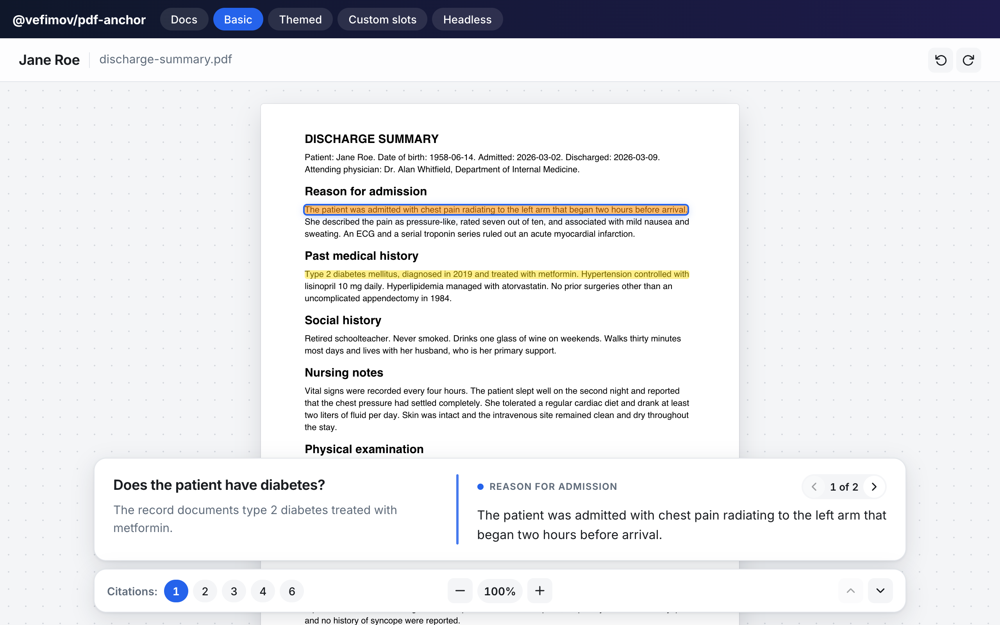
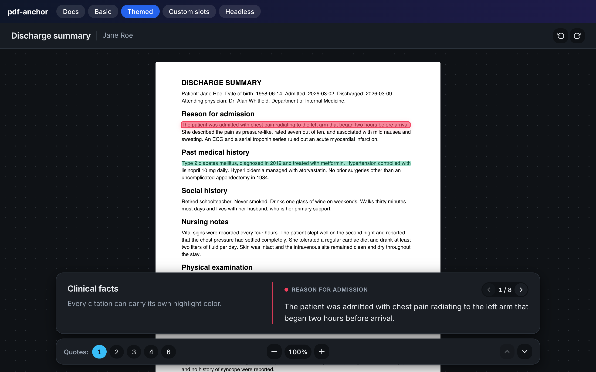
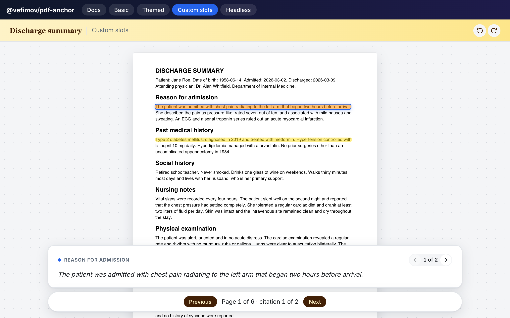
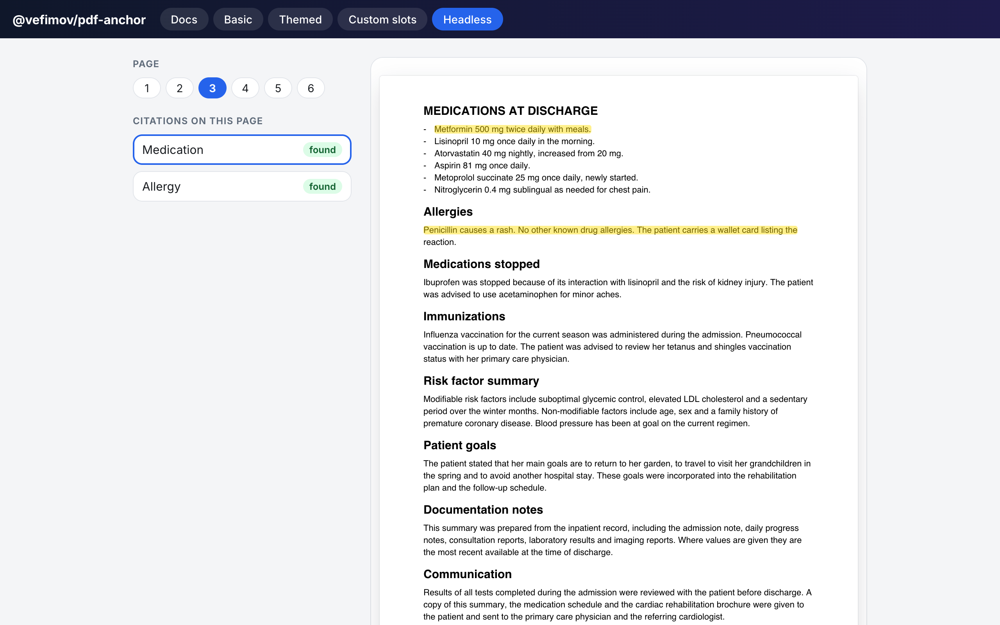
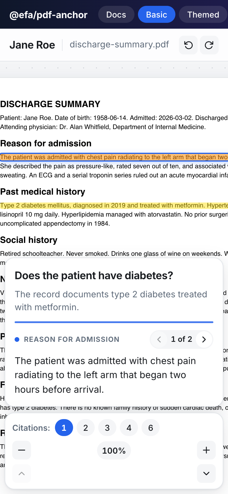

<h1 align="center">@vefimov/pdf-anchor</h1>

<p align="center">
  <b>Show people exactly where an answer came from.</b><br />
  Give it a PDF and a list of quotes. It finds each quote in the page text, highlights it,<br />
  and lets readers step from citation to citation.
</p>

<p align="center">
  <a href="https://valyefimov.github.io/pdf-anchor/"><b>Live demo</b></a> ·
  <a href="docs/api.md">API</a> ·
  <a href="docs/theming.md">Theming</a> ·
  <a href="docs/core.md">Core (no React)</a> ·
  <a href="docs/accessibility.md">Accessibility</a> ·
  <a href="docs/how-it-works.md">How it works</a>
</p>

<p align="center">
  <a href="https://github.com/valyefimov/pdf-anchor/actions/workflows/ci.yml"></a>
  
  
</p>

<p align="center">
  
</p>

<p align="center">
  <a href="docs/media/demo.mp4"><b>Watch the one-minute walkthrough (with voice-over)</b></a>
</p>

---

## Why

AI answers, extracted fields and audit findings are only trustworthy if a human can check them against the source. `@vefimov/pdf-anchor` turns _"the document says X"_ into _"here, on page 7, highlighted"_, without coordinates, bounding boxes or OCR output from your backend. You send text; it finds the place.

- **Matches text, not positions.** Passages are located with [`string-best-match`](https://github.com/valyefimov/string-best-match) (rolling hash + binary search), so punctuation, casing, line breaks and extra words around the quote don't break it.
- **A complete viewer.** Header, zoom, rotation, page paging, a citation panel with _n of N_ navigation and quick links to every page that carries a citation.
- **Keyboard and accessibility.** Arrow keys switch citations and pages, WCAG 2.2 AA tested with axe, see [Accessibility](docs/accessibility.md).
- **Fully themeable.** CSS variables, light/dark/auto, per-element `classNames` and `styles`, translatable labels, and render props to replace whole sections.
- **Headless when you need it.** A hook for your own UI, and a framework-agnostic core that works with any pdf.js text layer.
- **Small and tree-shakeable.** ESM and CJS, `sideEffects` limited to CSS, no CSS-in-JS runtime, no UI library dependency. TypeScript types included.

## Screenshots

| Dark scheme, per-citation colors, custom labels   | Custom slots and render props                       |
| ------------------------------------------------- | --------------------------------------------------- |
|  |  |

| Headless hook with your own UI            | On a phone                              |
| ----------------------------------------- | --------------------------------------- |
|  |  |

The images and the video are generated from the demo app with `node scripts/record-media.mjs`.

## Install

```bash
npm install @vefimov/pdf-anchor react react-dom react-pdf pdfjs-dist
```

`react`, `react-dom` and `react-pdf` are peer dependencies (`react` 18 or 19, `react-pdf` 11). They are optional if you only use [`@vefimov/pdf-anchor/core`](docs/core.md). Install the `pdfjs-dist` version that your `react-pdf` release depends on.

## Quick start

```tsx
import { PdfAnchorViewer, configurePdfWorker } from '@vefimov/pdf-anchor';
import '@vefimov/pdf-anchor/styles.css';
import 'react-pdf/dist/Page/TextLayer.css';
import workerSrc from 'pdfjs-dist/build/pdf.worker.min.mjs?url'; // Vite; see below for other bundlers

configurePdfWorker(workerSrc); // once, at startup

export function Report() {
  return (
    <PdfAnchorViewer
      file="/records/discharge-summary.pdf"
      title="Jane Roe"
      subtitle="discharge-summary.pdf"
      heading="Does the patient have diabetes?"
      description="The record documents type 2 diabetes treated with metformin."
      citations={[
        { page: 1, title: 'Diagnosis', text: 'Type 2 diabetes mellitus, diagnosed in 2019' },
        { page: 3, title: 'Medication', text: ['Metformin 500 mg', 'twice daily with meals'] },
      ]}
    />
  );
}
```

The viewer opens on the first citation's page, highlights what it finds, and shows the active quote in the panel at the bottom. Click a highlight, use the arrows, or jump to a page from the _Citations_ links.

<details>
<summary>Worker setup for other bundlers</summary>

```ts
// webpack 5 / Next.js
configurePdfWorker(new URL('pdfjs-dist/build/pdf.worker.min.mjs', import.meta.url));

// or serve the file yourself
configurePdfWorker('/static/pdf.worker.min.mjs');
```

</details>

## Where you can use it

| Use case                                               | What the citations are                                                                                       |
| ------------------------------------------------------ | ------------------------------------------------------------------------------------------------------------ |
| **AI answers with sources (RAG, chat over documents)** | The passages the model retrieved or quoted. Readers verify the answer in one click.                          |
| **Clinical and insurance record review**               | Facts extracted from charts, referrals and claims, shown on the page they came from.                         |
| **Legal and contract review**                          | Clauses flagged by a model or a reviewer: termination, liability, renewal terms.                             |
| **Compliance and audit trails**                        | Evidence for each control or finding, so an auditor can see the proof next to the claim.                     |
| **Document data extraction QA**                        | Invoice numbers, totals, dates, parties. Reviewers confirm or correct extracted fields against the original. |
| **Research and paper reading**                         | Quotes and key results collected by a tool, with a jump to the exact sentence.                               |
| **Customer support and knowledge bases**               | Link a support answer to the paragraph of the manual or policy it was based on.                              |
| **E-discovery and investigations**                     | Hits for a search term set, reviewed one by one.                                                             |
| **Education and annotation**                           | Teachers or students attach highlights to the right line of a reading.                                       |
| **Browser extensions and internal tools**              | A drop-in "open this PDF at the evidence" page. The viewer needs only a URL and a list of strings.           |

## Customize

```tsx
<PdfAnchorViewer
  file={url}
  citations={citations}
  colorScheme="auto" // 'light' | 'dark' | 'auto'
  theme={{ accent: '#0ea5e9', radius: '12px' }} // design tokens -> CSS variables
  classNames={{ panel: 'my-panel' }} // per-element classes
  styles={{ header: { background: '#fef3c7' } }} // per-element inline styles
  labels={{ citationOf: (n, total) => `${n} / ${total}` }}
  renderToolbar={({ state, actions }) => <MyToolbar {...state} {...actions} />}
/>
```

Give individual citations a `color`, show only the parts you want (`showHeader`, `showPanel`, `showToolbar`, `showRotate`), or walk the whole document with `citationScope="document"`. Everything is covered in [Theming](docs/theming.md) and the [API reference](docs/api.md).

## Build your own UI

```tsx
const containerRef = useRef<HTMLDivElement>(null);
const { results, notifyTextLayerRendered } = useCitationHighlights({
  containerRef,
  citations: pageCitations,
  activeIndex,
});

<div ref={containerRef}>
  <Document file={file}>
    <Page pageNumber={page} onRenderTextLayerSuccess={notifyTextLayerRendered} />
  </Document>
</div>;
```

`results[i].found` tells you whether each citation was located, so you can flag quotes that do not appear in the document.

## Without React

```ts
import {
  highlightCitations,
  setActiveHighlight,
  scrollToHighlight,
} from '@vefimov/pdf-anchor/core';
import '@vefimov/pdf-anchor/styles.css';

const results = highlightCitations(container, [{ page: 1, text: 'total amount due' }]);
scrollToHighlight(setActiveHighlight(container, 0));
```

The core only needs a DOM with a rendered pdf.js text layer. See [Core](docs/core.md).

## How it works

pdf.js renders each page's text as DOM spans. `@vefimov/pdf-anchor` flattens them into one word list, finds the longest run of words shared with your quote using `string-best-match`, and marks the spans that own those words. The details, thresholds (`minMatchWords`, `minMatchRatio`) and limits are in [How it works](docs/how-it-works.md).

Good to know: highlighting is per text-layer span, and the PDF must have a text layer (scanned images need OCR first).

## Security

- No `innerHTML`, `eval` or dynamic code. Titles, quotes and labels are rendered as React text.
- Citation colors are set as CSS custom properties, never as markup.
- The `file` you pass is loaded by pdf.js. Only load PDFs from sources you trust and set your CSP accordingly. Keep `pdfjs-dist` up to date.
- Report vulnerabilities as described in [SECURITY.md](SECURITY.md).

## Development

```bash
npm install
npm run typecheck && npm run lint && npm test   # checks
npm run build                                   # dist/

cd examples/react-vite && npm install && npm run dev   # demo app
node scripts/make-sample-pdf.mjs                       # regenerate the sample PDF
```

Contributions are welcome, see [CONTRIBUTING.md](CONTRIBUTING.md). Agents working in this repository should read [AGENTS.md](AGENTS.md).

## License

MIT © Valentyn Yefimov
